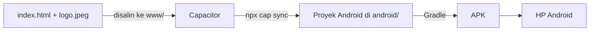

# Membuat Aplikasi Android (APK) dari NataData

> ## Status: belum dikonfigurasi
>
> Repository ini **belum memiliki** `package.json`, `capacitor.config.*`, folder `android/`, folder `www/`, maupun workflow pembuat APK. Tidak ada bukti bahwa APK NataData pernah dibuat, dipasang, atau diuji.
>
> Dokumen ini adalah **rencana langkah** untuk menambahkannya. Semua perintah di bawah **belum dijalankan** oleh penulis dokumen. Cocokkan dengan [dokumentasi resmi Capacitor](https://capacitorjs.com/docs) dan Android Studio sebelum dipakai, karena versi dan persyaratan dapat berubah.

## 1. Konsep

NataData adalah halaman web. **Capacitor** membungkus halaman web ke dalam aplikasi Android: sebuah *WebView* memuat `index.html` dari dalam paket APK. Kodenya tidak ditulis ulang.



Konsekuensi bagi NataData:

- **`localStorage` tetap dipakai**, tetapi tersimpan di WebView aplikasi. Data web dan data aplikasi **terpisah**, dan menghapus data aplikasi atau mencopot pemasangan menghapus datanya.
- **Aplikasi tetap butuh internet**, karena Tailwind, Lucide, Chart.js, dan font dimuat dari CDN. Tanpa sinyal, tampilan akan rusak. Solusi jangka panjang: simpan pustaka itu secara lokal di proyek (lihat [AUDIT.md](AUDIT.md)).

## 2. Persyaratan

| Perangkat | Keterangan |
|---|---|
| Node.js dan npm | Versi minimum mengikuti **versi Capacitor yang Anda pilih**. Periksa halaman persyaratan Capacitor. Belum dapat dipastikan dari repository ini. |
| Android Studio | Berisi Android SDK dan alat build |
| JDK | Sesuai anjuran Android Studio dan versi Android Gradle Plugin yang dipakai |
| HP Android atau emulator | Untuk uji coba |

## 3. Menyiapkan proyek (rencana)

Jalankan di folder repository.

**a. Buat `package.json` dan pasang Capacitor**

```bash
npm init -y
npm install @capacitor/core @capacitor/cli @capacitor/android
```

**b. Siapkan folder `www`** dan salin file web ke dalamnya:

```bash
mkdir www
cp index.html www/
cp logo.jpeg www/        # jika file ini ada
```

**c. Inisialisasi Capacitor.** Nama dan ID paket di bawah hanyalah **contoh**. ID paket (`appId`) menjadi identitas permanen aplikasi di Android dan **sebaiknya diputuskan oleh pemilik proyek sebelum rilis**.

```bash
npx cap init NataData id.contoh.natadata --web-dir=www
```

Perintah ini membuat `capacitor.config.*`. Pastikan isinya memuat `webDir: 'www'`.

**d. Tambah platform Android**

```bash
npx cap add android
```

## 4. Sinkronisasi file web ke Android

Setiap kali `index.html` berubah:

```bash
cp index.html www/
npx cap sync android
```

Menyalin `index.html` ke `www/` dilakukan manual. Menyimpan dua salinan berisiko tidak sinkron. Jika rencana ini dijalankan, putuskan satu sumber kebenaran, misalnya menjadikan `www/index.html` satu-satunya file kerja.

## 5. Membangun APK

**Lewat Android Studio:** `npx cap open android`, tunggu Gradle selesai, lalu **Build → Build Bundle(s) / APK(s) → Build APK(s)**.

**Lewat terminal (APK debug):**

```bash
cd android
./gradlew assembleDebug        # Windows: gradlew.bat assembleDebug
```

Lokasi hasil umumnya `android/app/build/outputs/apk/debug/app-debug.apk`. Lokasi ini **belum diverifikasi** untuk proyek ini.

## 6. APK debug vs APK rilis

| | Debug | Rilis |
|---|---|---|
| Penandatanganan | Kunci debug otomatis | Kunci milik Anda (keystore) |
| Untuk | Uji di perangkat sendiri | Dibagikan ke pengguna / toko aplikasi |
| Optimasi | Minim | Dapat diperkecil dan dioptimalkan |
| Aman dibagikan? | Tidak disarankan | Ya, jika ditandatangani benar |

## 7. Menandatangani APK rilis

1. Buat keystore (sekali saja) dengan `keytool` dari JDK, atau lewat Android Studio (**Build → Generate Signed Bundle / APK**).
2. **Simpan keystore dan kata sandinya dengan aman dan terpisah dari repository.** Jika hilang, Anda tidak bisa merilis pembaruan untuk aplikasi yang sama. `.gitignore` proyek ini sudah mengecualikan `*.keystore`, `*.jks`, dan `keystore.properties`.
3. **Jangan pernah** meng-commit keystore atau kata sandinya, dan jangan menuliskannya di dokumen.
4. Untuk distribusi lewat Google Play, format yang umumnya diminta adalah **AAB**, bukan APK. Periksa kebijakan Play Console terbaru.

## 8. Menguji di perangkat Android

1. Di HP: **Pengaturan → Tentang ponsel**, ketuk *Nomor build* 7 kali untuk mengaktifkan Opsi Pengembang, lalu aktifkan **USB debugging**.
2. Sambungkan lewat USB, lalu jalankan `npx cap run android` atau tekan Run di Android Studio.
3. Atau salin file APK ke HP dan pasang (perlu mengizinkan pemasangan dari sumber tidak dikenal).

Yang perlu diuji: masuk, tambah barang, jual, muat ulang aplikasi (data tetap ada?), mode pesawat (tampilan rusak karena CDN?), tombol Back Android, rotasi layar.

## 9. Masalah build yang umum (semuanya dugaan, belum diverifikasi)

| Gejala | Kemungkinan penyebab | Perbaikan |
|---|---|---|
| `npx cap add android` gagal | Versi Node terlalu lama | Perbarui Node sesuai persyaratan Capacitor |
| `Could not find webDir` | Folder `www` belum ada atau `webDir` salah | Buat `www/`, cek `capacitor.config.*` |
| Gradle gagal mengunduh | Tidak ada internet atau proxy | Periksa koneksi, buka ulang sinkronisasi Gradle |
| `SDK location not found` | Android SDK belum terpasang | Pasang SDK lewat Android Studio |
| Versi Java tidak cocok | JDK tidak sesuai Gradle/AGP | Pakai JDK bawaan Android Studio |
| Layar putih saat dibuka | Error JavaScript atau CDN tidak termuat | Lihat log lewat `chrome://inspect` |
| APK tidak bisa dipasang | Izin sumber tidak dikenal mati, atau paket bentrok | Lihat [TROUBLESHOOTING.md](TROUBLESHOOTING.md) |

## 10. GitHub Actions untuk APK

**Belum ada.** Workflow yang ada hanya `pages.yml` untuk website. Membuat workflow APK memerlukan keputusan tentang JDK, cara menyimpan keystore sebagai *secret*, dan lokasi hasil build. Setelah workflow dibuat, hasilnya diunduh lewat tab **Actions → pilih run → bagian Artifacts**. Langkah ini baru bisa didokumentasikan secara akurat setelah workflow benar-benar ada dan dijalankan.
