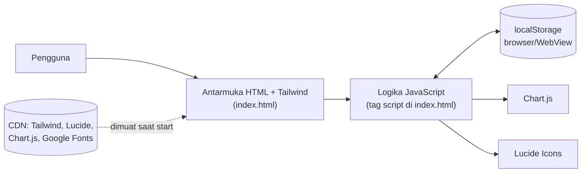
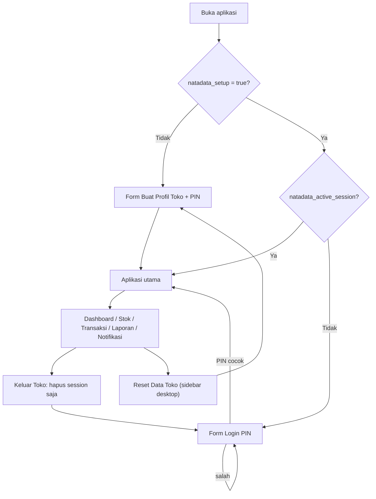
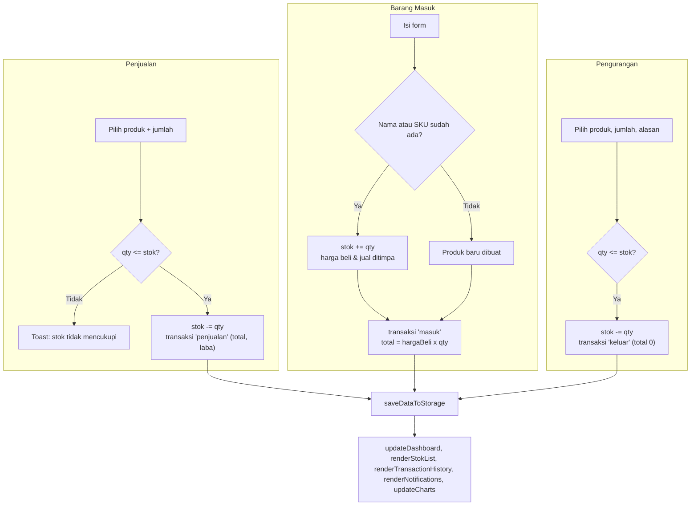
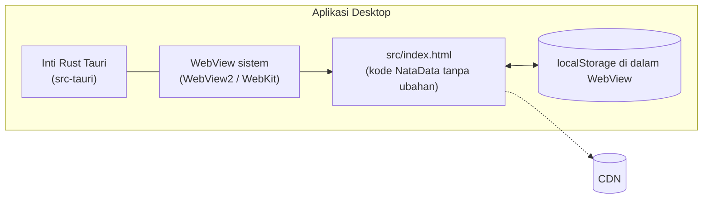

# Arsitektur NataData

Dokumen ini menjelaskan arsitektur **yang benar-benar ada di kode** (`index.html`). Bagian Tauri ditandai *(rencana)* karena belum ada di repository.

## 1. Gambaran umum

NataData adalah *single-page application* tanpa framework dan tanpa server. Semua logika berjalan di browser, dan data disimpan di `localStorage`.

Tidak ditemukan: backend, API, database online, autentikasi sungguhan, service worker, atau manifest PWA.

## 2. Komponen utama

| Komponen | Letak di `index.html` | Fungsi |
|---|---|---|
| Layar autentikasi | `#authScreen`, `#formRegister`, `#formLogin` | Pendaftaran toko + PIN, login PIN |
| Kerangka aplikasi | `#mainApp` | Sidebar desktop (`<aside class="hidden md:flex">`), header + navigasi bawah untuk ponsel |
| Lima "tab" | `#viewDashboard`, `#viewStok`, `#viewTransaksi`, `#viewLaporan`, `#viewNotifikasi` | Dipindah oleh `switchTab()` dengan menyembunyikan/menampilkan elemen |
| Tiga sub-form transaksi | `#formBarangMasuk`, `#formPenjualan`, `#formBarangKeluar` | Dipindah oleh `switchSubTrans()` |
| Modal | `#modalBarang`, `#modalNamaToko`, `#modalConfirmDelete` | Edit produk, ubah toko/logo, konfirmasi (hapus, keluar, reset) |
| Toast | `#toastNotification` | Pesan sukses/galat (`showToast()`) |

## 3. Tanggung jawab fungsi JavaScript

| Kelompok | Fungsi | Tugas |
|---|---|---|
| Startup & sesi | `window.onload`, `checkAuthState`, `handleRegister`, `handleLoginAuth`, `handleLogout`, `showMainApp` | Menentukan layar yang tampil berdasarkan `localStorage` |
| Persistensi | `loadStoreData`, `saveDataToStorage` | Membaca/menulis state ke `localStorage` |
| Tampilan | `updateStoreNameUI`, `switchTab`, `updateDashboard`, `renderStokList`, `renderTransactionHistory`, `renderNotifications`, `populateSelectOptions` | Membangun ulang HTML dari array `items` dan `transactions` |
| Stok | `handleSaveEditBarang`, `deleteBarang`, `executeDelete`, `filterKategori` | Edit, hapus, filter |
| Transaksi | `handleBarangMasuk`, `handlePenjualan`, `handleBarangKeluar`, `updateCalcPenjualan` | Mengubah stok dan menambah riwayat |
| Laporan | `initCharts`, `updateCharts` | Menghitung ringkasan dan menggambar grafik |
| Utilitas | `generateId`, `getIsoDateStr`, `formatDateTime`, `formatRp`, `escapeHTML` | Pembantu. (`sanitizeInput` terdefinisi tetapi tidak dipakai.) |

Pola render: setiap perubahan data memanggil rangkaian `saveDataToStorage()` lalu fungsi `render*`/`update*` yang membangun ulang `innerHTML`. Tidak ada state management terpisah. State global: `items`, `transactions`, `storeName`, `storeLogo`.

## 4. Model data

### Produk (`items[]`)

| Field | Tipe | Keterangan |
|---|---|---|
| `id` | string | `crypto.randomUUID()` (cadangan: `Date.now()` + acak) |
| `sku` | string | Otomatis `SKU-XXXXXX` bila kosong |
| `nama`, `kategori`, `satuan` | string | Kategori: Makanan/Minuman/Sembako/Lainnya |
| `hargaBeli`, `hargaJual` | number | Rupiah |
| `stok`, `minStok` | number | Notifikasi bila `stok <= minStok` |

### Transaksi (`transactions[]`, terbaru di awal via `unshift`)

| Field | Keterangan |
|---|---|
| `id` | `TRX-` + 8 karakter acak |
| `tipe` | `penjualan`, `masuk`, atau `keluar` |
| `itemNama`, `qty`, `satuan` | **Nama** produk disalin ke transaksi, bukan `id` produk |
| `total` | Penjualan: harga jual × qty. Masuk: harga beli × qty. Keluar: 0 |
| `laba` | Penjualan: (jual − beli) × qty. Lainnya: 0 |
| `dateIso`, `timestamp` | `YYYY-MM-DD` (zona waktu lokal) dan ISO-UTC |
| `catatan` | Masuk: catatan/supplier. Keluar: alasan. Penjualan: tidak ada |

Konsekuensi desain: karena transaksi menyimpan nama (bukan relasi ke produk), mengganti nama produk atau menghapus produk **tidak mengubah riwayat lama**, dan "produk terlaris" mengelompokkan berdasarkan nama.

## 5. Mekanisme penyimpanan

Kunci `localStorage` yang digunakan:

| Kunci | Isi |
|---|---|
| `natadata_setup` | `"true"` bila toko sudah dibuat |
| `natadata_password` | PIN 6 angka, **teks biasa** |
| `natadata_active_session` | `"true"` bila sedang login |
| `natadata_store_name`, `natadata_logo` | Nama toko dan URL/jalur logo |
| `natadata_items`, `natadata_trx` | JSON array produk dan transaksi |

Operasi data (CRUD):

| Operasi | Dilakukan oleh |
|---|---|
| Create produk | `handleBarangMasuk` (produk baru) |
| Read | `loadStoreData` + fungsi render |
| Update produk | `handleSaveEditBarang` (edit langsung, **tidak mencatat transaksi**), `handleBarangMasuk` (tambah stok + timpa harga), `handlePenjualan`/`handleBarangKeluar` (kurangi stok) |
| Delete produk | `deleteBarang` → `executeDelete` (permanen, riwayat tetap) |
| Reset | `executeDelete` dengan aksi `RESET_ACTION` memanggil `localStorage.clear()` |

Tidak ada penanganan galat untuk `JSON.parse` dan `localStorage.setItem` (misalnya data rusak atau kuota penuh).

## 6. Alur interaksi pengguna

## 7. Alur proses transaksi

## 8. Dependensi dan integrasi eksternal

| Dependensi | Cara dimuat | Risiko |
|---|---|---|
| Tailwind CSS | `<script src="https://cdn.tailwindcss.com">` | Butuh internet; tidak untuk produksi; gaya hilang bila gagal dimuat |
| Lucide | `unpkg.com/lucide@latest` | Versi bisa berubah sewaktu-waktu |
| Chart.js | `cdn.jsdelivr.net/npm/chart.js` | Versi tidak dikunci; laporan gagal bila tidak termuat |
| Google Fonts (Inter) | `<link>` | Hanya tampilan (ada fallback `sans-serif`) |

Tidak ada panggilan `fetch`/API lain di kode. Satu-satunya sumber eksternal selain CDN adalah URL logo yang diketik pengguna.

## 9. Arsitektur dengan Tauri *(rencana, belum ada di repository)*

- Kode web tidak berubah; Tauri hanya memuat `src/` di jendela WebView dan membungkusnya menjadi installer.
- Inti Rust bawaan tidak berisi logika bisnis NataData.
- Lokasi fisik `localStorage` bergantung WebView dan OS, dan **belum diverifikasi**.
- Rincian: [TAURI_BUILD.md](TAURI_BUILD.md).
