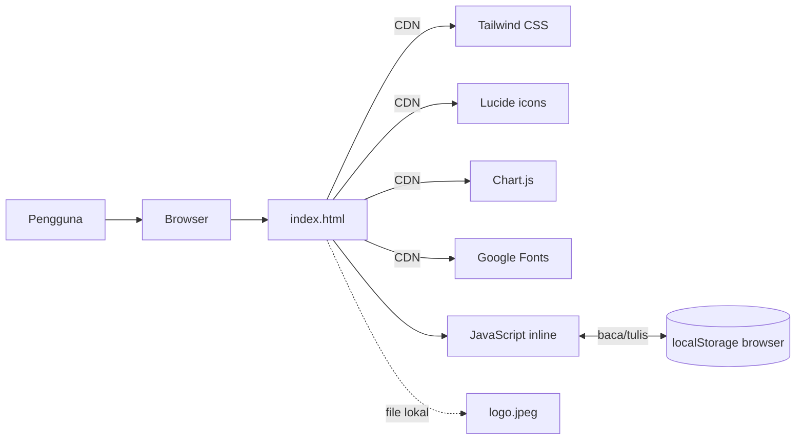
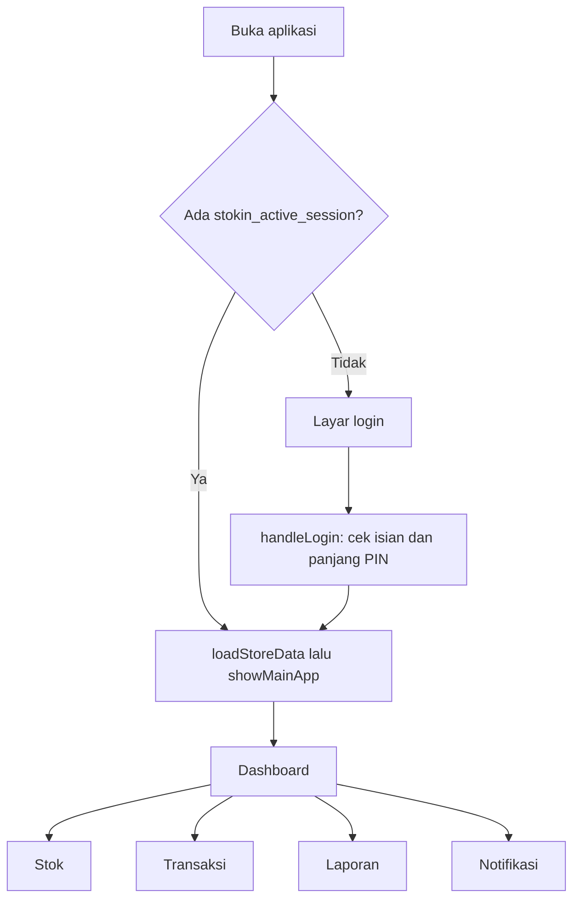
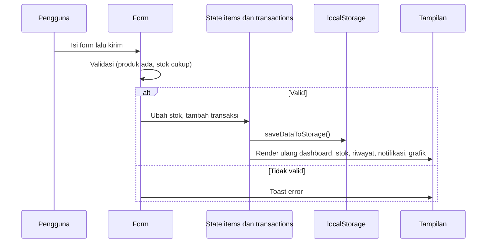

# Arsitektur NataData

Dokumen ini menjelaskan **implementasi aktual** di `index.html` (1.718 baris). Nomor baris merujuk ke file tersebut dan bisa bergeser jika file diubah.

## 1. Gambaran Umum

NataData adalah *single-page application* tanpa framework dan tanpa backend. Satu file HTML berisi tiga hal:

| Bagian | Lokasi di `index.html` | Isi |
|---|---|---|
| Head | baris 3–23 | Pemuatan Tailwind, Lucide, Chart.js, font Inter, dan CSS kecil |
| Markup | baris 26–723 | Layar login, kerangka aplikasi, 5 tampilan, 3 modal |
| Logika | baris 725–1717 | Satu blok `<script>` berisi state, fungsi render, dan penyimpanan |



Tidak ditemukan: panggilan API (`fetch`/`XMLHttpRequest`), database, autentikasi server, *service worker*, atau manifest PWA.

## 2. Komponen Utama

| Komponen | Id elemen | Fungsi |
|---|---|---|
| Layar login | `authScreen` | Form ID Toko, Nama Toko, PIN |
| Kerangka aplikasi | `mainApp` | Sidebar (desktop), header dan bottom nav (mobile), area konten |
| Dashboard | `viewDashboard` | Ringkasan harian |
| Stok | `viewStok` | Daftar, cari, filter produk |
| Transaksi | `viewTransaksi` | 3 form (Barang Masuk, Penjualan, Penyesuaian) dan riwayat |
| Laporan | `viewLaporan` | Angka ringkasan dan 2 grafik |
| Notifikasi | `viewNotifikasi` | Daftar stok menipis |
| Modal edit produk | `modalBarang` | Ubah data produk |
| Modal ubah toko | `modalNamaToko` | Ubah nama dan URL logo |
| Modal konfirmasi | `modalConfirmDelete` | **Dipakai bersama** untuk hapus produk, reset data, dan keluar |

## 3. Peta Fungsi

| Fungsi | Baris | Tanggung jawab |
|---|---|---|
| `window.onload` | 765 | Menampilkan tanggal, memulihkan sesi dari `localStorage` |
| `sanitizeInput` | 783 | Meng-*escape* `& < > " '` |
| `handleLogin` | 790 | Validasi form, membuat `activeStoreId`, memuat data |
| `loadStoreData` / `saveDataToStorage` | 809 / 825 | Baca dan tulis data toko |
| `showMainApp` | 833 | Render semua tampilan setelah masuk |
| `handleLogout` / `resetDataDefault` | 847 / 854 | Membuka modal konfirmasi |
| `executeDelete` | 1194 | Mengeksekusi aksi modal konfirmasi: keluar, reset, atau hapus produk |
| `switchTab` / `switchSubTrans` | 927 / 1275 | Pindah tampilan dan sub-form |
| `updateDashboard` | 973 | Hitung dan isi kartu dashboard |
| `renderStokList` | 1040 | Daftar produk (dengan pencarian dan filter) |
| `handleSaveEditBarang` / `deleteBarang` | 1138 / 1167 | Edit dan hapus produk |
| `handleBarangMasuk` | 1300 | Tambah produk baru atau tambah stok |
| `handlePenjualan` | 1377 | Catat penjualan |
| `handleBarangKeluar` | 1436 | Catat penyesuaian stok |
| `renderTransactionHistory` | 1487 | Riwayat transaksi |
| `renderNotifications` | 1535 | Daftar stok menipis |
| `initCharts` / `updateCharts` | 1576 / 1636 | Membuat dan memperbarui grafik serta angka laporan |

## 4. Model Data

State berada di variabel global: `activeStoreId`, `storeName`, `storeLogo`, `items`, `transactions`.

**Produk** (`items[]`)

```js
{ id, sku, nama, kategori, satuan, hargaBeli, hargaJual, stok, minStok }
```

`kategori` bernilai salah satu: `Makanan`, `Minuman`, `Sembako`, `Lainnya`. Produk baru memakai `id: Date.now()`, sedangkan data contoh memakai 1–4.

**Transaksi** (`transactions[]`, yang terbaru di indeks 0)

```js
{ id, tipe, itemNama, qty, total, laba, tglDisplay, dateIso, catatan? }
```

| `tipe` | Arti | `total` | `laba` |
|---|---|---|---|
| `penjualan` | Barang terjual | `hargaJual × qty` | `(hargaJual − hargaBeli) × qty` |
| `masuk` | Barang masuk | `hargaBeli × qty` (modal keluar) | 0 |
| `keluar` | Penyesuaian stok | 0 | 0 |

Transaksi menyimpan **nama produk** (`itemNama`), bukan id produk. Tidak ada relasi ke produk.

## 5. Mekanisme Penyimpanan

Semua data disimpan di `localStorage` dengan kunci berikut. Awalan `stokin_` adalah nama lama dan **tidak berubah** walau mereknya kini NataData.

| Kunci | Isi |
|---|---|
| `stokin_active_session` | ID toko yang sedang aktif (untuk masuk otomatis) |
| `stokin_name_<idToko>` | Nama toko |
| `stokin_logo_<idToko>` | URL logo (atau `logo.jpeg`) |
| `stokin_items_<idToko>` | JSON daftar produk |
| `stokin_trx_<idToko>` | JSON daftar transaksi |

| Operasi | Cara |
|---|---|
| Create | `items.push(...)` / `transactions.unshift(...)`, lalu `saveDataToStorage()` |
| Read | `loadStoreData()` saat masuk atau memulihkan sesi |
| Update | Ubah objek di memori, lalu `saveDataToStorage()` |
| Delete | `items.splice(...)` setelah konfirmasi. **Transaksi tidak bisa dihapus.** |

Setiap perubahan menulis ulang seluruh data toko. Tidak ada versi skema, migrasi, atau penanganan kuota penuh.

## 6. Alur Interaksi Pengguna



## 7. Alur Transaksi



Aturan per jenis transaksi:

- **Penjualan:** ditolak bila `qty > stok`. Stok berkurang, laba dihitung dari selisih harga.
- **Barang masuk:** produk dianggap **sudah ada** jika nama sama (tanpa membedakan huruf besar/kecil) atau SKU sama. Jika ada: stok bertambah, harga beli dan jual diperbarui bila diisi. Jika tidak: produk baru dibuat.
- **Penyesuaian:** ditolak bila `qty > stok`. Stok berkurang, nilai transaksi 0.

## 8. Dua Definisi "Laba"

| Lokasi | Rumus | Arti |
|---|---|---|
| Dashboard, "Laba Bersih (Hari Ini)" | Jumlah `laba` penjualan hari ini | Margin atas barang yang terjual |
| Laporan, "Saldo Kas Bersih" | Total omset − total modal restock (seluruh waktu) | Arus kas sederhana |

Keduanya sah, tetapi berbeda dan bisa membingungkan jika dibaca sebagai hal yang sama.

## 9. Dependensi Eksternal

| Layanan | URL | Dikunci versi? |
|---|---|---|
| Tailwind CSS | `https://cdn.tailwindcss.com` | Tidak |
| Lucide | `https://unpkg.com/lucide@latest` | Tidak (`latest`) |
| Chart.js | `https://cdn.jsdelivr.net/npm/chart.js` | Tidak |
| Google Fonts (Inter) | `https://fonts.googleapis.com/...` | Tidak berlaku |

## 10. Arsitektur Android

**Belum ada.** Tidak ada `capacitor.config.*`, folder `android/`, atau `package.json` pada kode yang diaudit. Lihat [ANDROID_BUILD.md](ANDROID_BUILD.md) untuk rencana.
