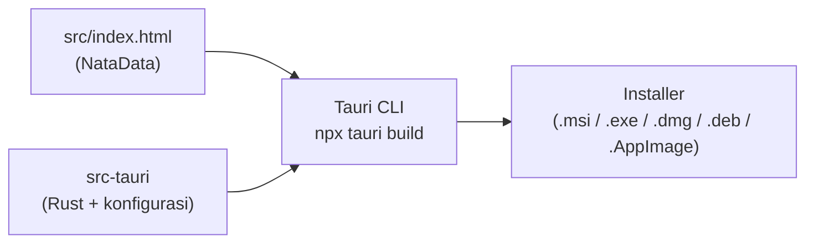

# Membuat Aplikasi NataData dengan Tauri

Panduan langkah demi langkah mengubah NataData (satu file HTML) menjadi **aplikasi desktop** (Windows, macOS, Linux) dan, opsional, **APK Android** memakai **Tauri v2**.

> **Status verifikasi (baca dulu).**
> - Isi kode NataData **sudah diperiksa** dari file yang diunggah.
> - Perintah dan struktur konfigurasi Tauri di bawah mengikuti dokumentasi Tauri v2 (`https://v2.tauri.app`), **tetapi belum dijalankan terhadap proyek NataData**. Lingkungan tempat dokumen ini disusun tidak punya akses internet untuk membangun proyek, sehingga **tidak ada klaim bahwa installer/APK berhasil dibuat atau diuji**.
> - Bagian bertanda **[Belum diverifikasi]** adalah dugaan berdasarkan dokumentasi/pengetahuan umum. Jika hasil di komputer Anda berbeda, ikuti pesan galat dan dokumentasi resmi, lalu perbarui dokumen ini.
> - Perintah `npx tauri ...` mengikuti Tauri v2. Tauri v1 memakai format konfigurasi yang berbeda.

## Daftar isi

1. [Konsep: bagaimana web menjadi aplikasi](#1-konsep)
2. [Prasyarat](#2-prasyarat)
3. [Menyiapkan folder proyek](#3-menyiapkan-folder-proyek)
4. [Memasang Tauri CLI](#4-memasang-tauri-cli)
5. [Inisialisasi Tauri](#5-inisialisasi-tauri)
6. [Mengatur `tauri.conf.json`](#6-mengatur-tauriconfjson)
7. [Membuat ikon aplikasi](#7-membuat-ikon-aplikasi)
8. [Menjalankan mode pengembangan](#8-menjalankan-mode-pengembangan)
9. [Membangun installer](#9-membangun-installer)
10. [Menguji aplikasi](#10-menguji-aplikasi)
11. [Hal khusus NataData yang harus diketahui](#11-hal-khusus-natadata)
12. [Android dengan Tauri (opsional)](#12-android-opsional)
13. [Distribusi dan penandatanganan](#13-distribusi-dan-penandatanganan)
14. [GitHub Actions (usulan)](#14-github-actions-usulan)
15. [Masalah umum](#15-masalah-umum)

---

## 1. Konsep

Tauri membuat jendela aplikasi yang menampilkan kode web Anda memakai **WebView bawaan sistem** (WebView2 di Windows, WebKit di macOS/Linux). Bagian Rust (`src-tauri`) mengurus jendela dan pembuatan installer. Kode NataData (HTML/JS) **tetap sama** dan berjalan di dalam jendela itu.



Konsekuensi untuk NataData:
- Data di `localStorage` kini berada **di dalam aplikasi** (bukan di browser Anda). Bentuk dan lokasinya bergantung WebView **[Belum diverifikasi]**.
- Pustaka dari CDN tetap butuh internet (lihat [bagian 11](#11-hal-khusus-natadata)).

## 2. Prasyarat

### Windows (utama)

| Kebutuhan | Cara pasang |
|---|---|
| Microsoft C++ Build Tools | Unduh dari situs Visual Studio, pilih beban kerja **"Desktop development with C++"** |
| WebView2 | Sudah ada di Windows 10 versi 1803+ dan Windows 11. Pasang manual bila belum ada |
| Rust | `winget install Rustlang.Rustup` (atau dari rustup.rs), lalu **buka ulang terminal** |
| Node.js LTS | Dari nodejs.org |

### macOS / Linux

- **macOS:** `xcode-select --install` (untuk desktop saja), lalu Rust dan Node.js.
- **Linux:** paket pengembangan WebKitGTK dan pustaka pendukung sesuai distro (nama paket berbeda-beda; lihat halaman *Prerequisites* di v2.tauri.app), lalu Rust dan Node.js. **[Belum diverifikasi untuk distro Anda]**

### Periksa instalasi

```bash
rustc --version
cargo --version
node -v
npm -v
```

Jika salah satunya "not recognized", tutup dan buka ulang terminal, atau cek PATH.

## 3. Menyiapkan folder proyek

Buat folder proyek (atau pakai hasil `git clone` repository NataData), lalu susun seperti ini:

```text
natadata/
└── src/
    ├── index.html        # file NataData (ganti nama dari natadata_aplikasi_manajemen_stok_umkm__1_.html)
    ├── logo.jpeg
    └── img/
        └── logo.jpeg
```

Perintah (Windows PowerShell; sesuaikan jalur file unggahan Anda):

```powershell
mkdir natadata
cd natadata
mkdir src\img
copy "C:\jalur\natadata_aplikasi_manajemen_stok_umkm__1_.html" src\index.html
copy "C:\jalur\logo.jpeg" src\logo.jpeg
copy "C:\jalur\logo.jpeg" src\img\logo.jpeg
```

Mengapa **dua** salinan logo? Kode memakai `logo.jpeg` pada tag `` awal dan `img/logo.jpeg` pada konstanta `DEFAULT_LOGO`. Lihat [AUDIT, T-03](AUDIT_DAN_REKOMENDASI.md#t-03). Anda mengatakan logo sudah tampil di versi Anda, jadi pastikan **struktur folder Anda yang sudah berjalan** tetap dipertahankan di `src/`.

Sebelum lanjut, buka `src/index.html` di browser dan pastikan aplikasi tampil normal.

## 4. Memasang Tauri CLI

Di folder `natadata/`:

```bash
npm init -y
npm install -D @tauri-apps/cli@latest
```

Lalu buka `package.json` dan tambahkan skrip `tauri` agar bisa memakai `npm run tauri ...`:

```json
{
  "name": "natadata",
  "version": "0.1.0",
  "private": true,
  "scripts": {
    "tauri": "tauri"
  },
  "devDependencies": {
    "@tauri-apps/cli": "^2"
  }
}
```

(Nomor versi persisnya akan berbeda di komputer Anda; biarkan yang ditulis npm.)

## 5. Inisialisasi Tauri

```bash
npx tauri init
```

Jawab pertanyaan interaktif (nama pertanyaan bisa sedikit berbeda antar versi) **[Belum diverifikasi persis]**:

| Pertanyaan | Isi |
|---|---|
| App name | `NataData` |
| Window title | `NataData` |
| Web assets location (relatif terhadap `src-tauri/tauri.conf.json`) | `../src` |
| URL dev server | kosongkan (NataData tidak memakai dev server) |
| Frontend dev command | kosongkan |
| Frontend build command | kosongkan |

Alternatif tanpa tanya-jawab (cek dulu opsi yang tersedia dengan `npx tauri init --help`):

```bash
npx tauri init --app-name NataData --window-title NataData --frontend-dist ../src
```

Hasilnya: folder `src-tauri/` berisi antara lain `tauri.conf.json`, `Cargo.toml`, `build.rs`, `src/` (kode Rust), dan `icons/`.

## 6. Mengatur `tauri.conf.json`

Buka `src-tauri/tauri.conf.json`. **Jangan mengganti seluruh isi**; ubah hanya bagian di bawah dan biarkan sisanya sesuai hasil `tauri init` (struktur v2).

```json
{
  "productName": "NataData",
  "version": "0.1.0",
  "identifier": "com.natadata.inventaris",
  "build": {
    "frontendDist": "../src"
  },
  "app": {
    "windows": [
      {
        "title": "NataData",
        "width": 1200,
        "height": 800,
        "minWidth": 380,
        "minHeight": 600,
        "resizable": true
      }
    ],
    "security": {
      "csp": null
    }
  },
  "bundle": {
    "active": true,
    "targets": "all"
  }
}
```

Penjelasan:

| Kunci | Fungsi | Catatan |
|---|---|---|
| `productName` | Nama aplikasi yang tampil | |
| `version` | Versi aplikasi | Naikkan setiap rilis |
| `identifier` | ID unik aplikasi (gaya terbalik) | **Keputusan pemilik proyek.** Setelah dirilis, mengubahnya dapat memengaruhi lokasi data pengguna **[Belum diverifikasi]**. Hindari akhiran `.app` |
| `build.frontendDist` | Folder aset web | Harus `../src` karena `src-tauri` ada satu tingkat di bawah akar |
| `app.windows[]` | Ukuran dan judul jendela | `minWidth: 380` menjaga tata letak ponsel/desktop tetap terbaca |
| `app.security.csp` | Kebijakan keamanan konten | `null` = tidak dibatasi, sehingga CDN dapat dimuat. Lihat bagian 11 |
| `bundle.targets` | Jenis installer | `"all"` = semua yang didukung OS yang sedang dipakai |

Bagian `bundle.icon` sudah dibuat oleh `tauri init`/`tauri icon` (bagian 7).

Jika Anda memakai `devUrl` kosong dan Tauri mengeluh saat `dev`, lihat [bagian 15](#15-masalah-umum).

## 7. Membuat ikon aplikasi

Ikon bawaan Tauri akan dipakai bila Anda melewati langkah ini. Untuk memakai logo NataData:

1. Ubah logo menjadi **PNG persegi** (disarankan 1024×1024). `tauri icon` tidak dirancang untuk JPEG **[Belum diverifikasi]**.
   - Dengan ImageMagick: `magick src/logo.jpeg -resize 1024x1024 icon.png`
   - Atau gunakan editor gambar / situs konversi.
2. Jalankan:

```bash
npx tauri icon icon.png
```

Ini membuat berbagai ukuran ikon di `src-tauri/icons/`.

## 8. Menjalankan mode pengembangan

```bash
npm run tauri dev
```

(atau `npx tauri dev`)

- Kompilasi pertama **lama** (mengunduh dan membangun pustaka Rust; bisa beberapa menit).
- Jendela "NataData" terbuka dengan aplikasi Anda.
- Karena frontend adalah folder statis tanpa dev server, kemungkinan Tauri menyajikan folder `src/` sendiri. Perubahan pada `index.html` mungkin perlu **muat ulang jendela** (Ctrl+R) atau menjalankan ulang perintah **[Belum diverifikasi]**.

## 9. Membangun installer

```bash
npm run tauri build
```

(atau `npx tauri build`)

Hasil biasanya berada di:

```text
src-tauri/target/release/bundle/
```

| OS | Jenis keluaran yang umum **[Belum diverifikasi]** |
|---|---|
| Windows | Installer `.msi` dan/atau `-setup.exe` (NSIS) |
| macOS | `.app` dan `.dmg` |
| Linux | `.deb`, `.rpm`, `.AppImage` |

Catatan:
- Build pertama mengunduh alat pembuat installer (misalnya WiX/NSIS di Windows), jadi butuh internet.
- Installer dibuat **untuk OS yang sedang Anda pakai**. Untuk Windows + macOS + Linux sekaligus, gunakan GitHub Actions ([bagian 14](#14-github-actions-usulan)).
- Tambahkan `.gitignore` agar folder besar tidak ikut ter-commit:

```gitignore
node_modules/
src-tauri/target/
```

## 10. Menguji aplikasi

Gunakan daftar uji di [DEVELOPMENT.md, bagian 7](DEVELOPMENT.md#7-menguji-perubahan), lalu tambahkan uji khusus aplikasi:

| # | Uji | Diharapkan |
|---|---|---|
| 1 | Jalankan installer di komputer bersih | Terpasang, ada pintasan "NataData" |
| 2 | Buka dengan internet menyala | Tampilan, ikon, dan grafik normal |
| 3 | Buat toko, tambah barang, tutup lalu buka aplikasi | Data masih ada |
| 4 | Buka dengan internet **mati** | Perkirakan tampilan rusak (lihat bagian 11) |
| 5 | Ubah ukuran jendela ke sempit | Tata letak menjadi mode ponsel |
| 6 | Copot aplikasi lalu pasang lagi | Cek apakah data tetap/hilang, lalu catat hasilnya di dokumen ini **[Belum diverifikasi]** |

## 11. Hal khusus NataData

1. **Ketergantungan CDN.** `index.html` memuat Tailwind, Lucide, dan Chart.js dari internet (baris 8, 10, 12, dan font di baris 14). Aplikasi desktop tanpa internet akan tampil tanpa gaya/ikon/grafik. Untuk aplikasi benar-benar offline, pustaka perlu dibundel lokal. Itu **mengubah kode aplikasi**, sehingga harus disetujui pemilik proyek. Arah umum **[Belum diverifikasi]**: pasang Tailwind lewat npm dan hasilkan satu file CSS, lalu simpan `lucide.min.js` dan `chart.umd.min.js` versi tetap di `src/vendor/` dan ubah tag `<script>`.
2. **Penyimpanan data.** `localStorage` di dalam WebView. Tidak ada sinkronisasi dan tidak ada ekspor. Pindah komputer = data tidak ikut. Jika `identifier` berubah antar versi, kemungkinan data lama tidak terbaca **[Belum diverifikasi]**.
3. **PIN.** Hanya pengunci tampilan; tersimpan teks biasa. Pembungkusan dengan Tauri **tidak** membuatnya aman.
4. **Reset dan lupa PIN.** Tombol reset hanya ada di sidebar desktop setelah login. Pada aplikasi desktop, tidak ada menu "hapus data situs" seperti di browser; cara pemulihan bila lupa PIN perlu diuji dan didokumentasikan **[Belum diverifikasi]**.
5. **CSP `null`** dipakai agar CDN termuat. Setelah pustaka dibundel lokal, kunci CSP (misalnya hanya `'self'`) sebagai perbaikan keamanan.

## 12. Android (opsional)

Tauri v2 mendukung Android, tetapi persiapannya jauh lebih panjang. Semua langkah di bagian ini **[Belum diverifikasi]**.

**Prasyarat:** Android Studio (SDK Platform + Platform-Tools + **NDK** + Build-Tools), **JDK** sesuai dokumentasi Tauri, dan variabel lingkungan `JAVA_HOME`, `ANDROID_HOME`, `NDK_HOME`. Tambahkan target Rust:

```bash
rustup target add aarch64-linux-android armv7-linux-androideabi i686-linux-android x86_64-linux-android
```

**Langkah:**

```bash
npx tauri android init              # membuat proyek Android di src-tauri/gen/android
npx tauri android dev               # jalankan di emulator/perangkat tersambung
npx tauri android build --apk       # membuat APK
```

- Keluaran APK berada di bawah `src-tauri/gen/android/app/build/outputs/apk/` (jalur persis bisa berbeda).
- **APK debug** ditandatangani kunci debug dan bisa dipasang untuk uji coba. **APK rilis** harus ditandatangani dengan keystore milik Anda agar bisa dipasang/distribusi. **Simpan keystore dan sandinya di luar repository** dan jangan pernah meng-commit-nya.
- Memasang di HP: aktifkan "Pasang dari sumber tidak dikenal" dan USB debugging, lalu pasang APK.
- Aplikasi memuat CDN, jadi HP perlu internet.
- Tampilan NataData sudah responsif (navigasi bawah pada layar sempit), tetapi **belum diuji** di WebView Android.
- Pada layar HP, tombol **Reset Data Toko** tidak tersedia (sidebar disembunyikan di bawah lebar `md`).

## 13. Distribusi dan penandatanganan

- Installer yang tidak ditandatangani biasanya memicu peringatan keamanan (misalnya Windows SmartScreen). Sertifikat penandatangan kode umumnya berbayar. Perilaku persisnya **[Belum diverifikasi]**.
- Jangan menaruh sertifikat, keystore, atau sandi di repository. Gunakan GitHub Secrets bila perlu.
- Sebelum dibagikan ke pengguna nyata, selesaikan temuan **Prioritas kritis** di [AUDIT_DAN_REKOMENDASI.md](AUDIT_DAN_REKOMENDASI.md) (terutama cadangan data).

## 14. GitHub Actions (usulan)

> **Ini usulan, bukan file yang ada di repository, dan belum dijalankan.** Letakkan sebagai `.github/workflows/build-desktop.yml` hanya bila Anda setuju. Periksa versi *action* terbaru sebelum memakai.

```yaml
name: Build desktop

on:
  workflow_dispatch:

jobs:
  build-windows:
    runs-on: windows-latest
    steps:
      - uses: actions/checkout@v4
      - uses: actions/setup-node@v4
        with:
          node-version: lts/*
      - uses: dtolnay/rust-toolchain@stable
      - run: npm install
      - run: npx tauri build
      - uses: actions/upload-artifact@v4
        with:
          name: natadata-windows
          path: src-tauri/target/release/bundle/**
```

Cara memakai: tab **Actions** → pilih "Build desktop" → **Run workflow** → setelah selesai, unduh artefak di bagian **Artifacts** pada halaman run. Penjelasan lain: [DEPLOYMENT.md](DEPLOYMENT.md).

## 15. Masalah umum

Daftar lengkap: [TROUBLESHOOTING.md](TROUBLESHOOTING.md). Ringkasan:

| Gejala | Dugaan penyebab / tindakan |
|---|---|
| `npx tauri` tidak dikenal | `npm install -D @tauri-apps/cli@latest` belum dijalankan di folder ini |
| `link.exe not found` / galat C++ | Build Tools "Desktop development with C++" belum terpasang |
| `rustc`/`cargo` tidak dikenal | Terminal belum dibuka ulang setelah memasang Rust |
| Jendela kosong/putih | `frontendDist` salah (harus `../src`) atau `src/index.html` tidak ada |
| Tauri meminta `devUrl` saat `dev` | Isi `build.devUrl` sesuai dokumentasi v2 atau gunakan server statis; periksa `npx tauri dev --help` **[Belum diverifikasi]** |
| Tampilan tanpa gaya | Tidak ada internet (CDN) |
| Build sangat lama pertama kali | Normal; kompilasi awal |
